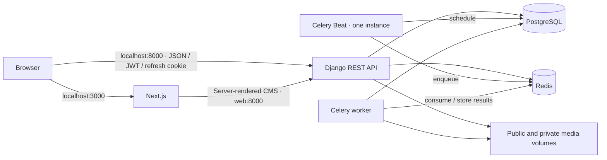

# Mallbyte

Mallbyte is a marketplace with a customer storefront, seller workspaces and an operations console. The Next.js frontend and Django REST API share a release commit. PostgreSQL stores business data, Redis backs the shared cache and task queue, and Celery handles scheduled and asynchronous work.

## Start locally

Use a Linux development host with Git, Python 3, Docker Engine running Linux containers, and the Docker Compose plugin. The bootstrap uses only the Python standard library. From the repository root on `chore/monorepo-integration`, run:

```sh
python3 scripts/init-dev-env.py
docker compose up -d --build --wait --wait-timeout 300
docker compose ps --all
```

The first command generates a private root `.env` once. The second command builds and starts the full stack. A successful migration container exits with status 0. The storefront opens at **http://localhost:3000**, the API at **http://localhost:8000**, and the interactive API schema at **http://localhost:8000/swagger/**. Use `localhost` consistently for both browser origins.

**Coming from Windows via VS Code Remote SSH?** Clone the integration branch from the monorepo, start the stack on Linux, then forward ports **3000** and **8000** to the same local ports. In WSL2, use the same Linux commands in a Linux checkout with access to a Docker engine. On native Windows, the environment generator also runs as `py -3 scripts/init-dev-env.py`. [Clone, transfer and verify on Linux](docs/linux-verification.md)

## Architecture



| Component | Implementation | Responsibility |
| --- | --- | --- |
| Frontend | Next.js 16 App Router, React 19, TypeScript, Tailwind CSS, Axios and Zustand | Storefront, seller and admin interfaces, browser sessions, server-rendered content pages |
| API | Python 3.13 in Docker, Django 5.2, Django REST Framework and Simple JWT | Accounts, MFA, roles, catalog, stock, orders, payments, shipping, returns, settlements, content and reporting |
| Storage | PostgreSQL 16 and separate public/private media volumes | Relational data and uploads, with application-controlled access to private files |
| Background services | Redis 7, Celery and django-celery-beat | Cache and throttling, messaging, task results and database-backed schedules |
| Delivery | GitHub Actions, production Dockerfiles, Gunicorn, standalone Next.js and Nginx | Per-service checks, integration tests, packaged releases and a manually authorized deployment |

The development project publishes only two loopback ports. The frontend shares an application network with Django. PostgreSQL, Redis, the worker, Beat and Django share a second network. A one-shot service applies migrations after PostgreSQL and Redis pass their health checks. Django, the worker and Beat wait for it to succeed. Next.js waits for the Django liveness probe. Worker health uses a targeted Celery ping. Beat's process starts under Compose and its schedule is stored in PostgreSQL.

## Repository layout

| Path | Contents |
| --- | --- |
| `frontend/` | Next.js application, feature modules, lockfile, Vitest and Playwright suites, development and production image stages |
| `backend/` | Django apps and migrations, settings, Python requirements, production gateway, staging/recovery manifests and operator runbooks |
| `.github/workflows/` | Ten migrated component workflows, full-stack CI and manual production delivery |
| `compose.yaml`, `.env.example`, `scripts/` | Local project definition, environment template and credential generator |
| `docs/` | Linux verification, deployment contract and migration report |

Each application owns its dependencies and image build context. Run service-specific commands in the directory indicated by its guide. [Frontend guide](frontend/README.md) · [Backend guide](backend/README.md)

## Environment and security

| Setting | Local behavior |
| --- | --- |
| `SECRET_KEY`, `DB_PASSWORD` | Generated independently in the root `.env`. Preserve this file across restarts. PostgreSQL initializes its password the first time it creates its data volume. |
| `FRONTEND_PORT`, `API_PORT` | Default to `3000` and `8000`. Compose derives published ports, browser URLs and the allowed CORS origin from these values. Match SSH forwarding to any overrides. |
| `NEXT_PUBLIC_API_BASE_URL` | Browser-reachable Django origin. Compose sets this to `http://localhost:<API_PORT>`. Production images embed their public HTTPS origin at build time. |
| `INTERNAL_API_BASE_URL` | Runtime origin for server-rendered CMS reads. Local containers use `http://web:8000`. Outside Compose it falls back to the public origin. |
| Mail and authentication | Local OTP mail goes to the Django console backend. Follow `docker compose logs -f web` privately while signing in. The API enforces roles and privileged MFA and issues an HttpOnly refresh cookie under `/api/auth/`. |
| Redis | Database 0 carries the broker, 1 the Django cache and 2 task results. Services use Compose DNS; database and cache access are available through `docker compose exec`. |

Local root credentials and machine-specific QA outputs are ignored. Production requires independent secrets, HTTPS, secure cookies, explicit origins and external PostgreSQL/Redis. Public frontend build arguments are visible to browsers. [Deployment configuration and secret names](docs/deployment.md)

## Development

Edits to `frontend/src/`, `frontend/public/`, `backend/apps/` and `backend/config/` are visible inside the development containers. Next.js and Django reload application code. Restart the worker and Beat after changing task code. Rebuild after changing dependencies, Dockerfiles or files outside the mounted directories. Run exactly one scheduler per project.

```sh
docker compose logs -f frontend web
docker compose exec web python manage.py migrate
docker compose exec web python manage.py createsuperuser
docker compose restart celery_worker celery_beat
docker compose down
```

Ordinary `down` retains named volumes for the database, Redis and uploaded media. Existing backend-only developer tools, Mailpit, staging manifests and recovery procedures are available in `backend/`. The host-side observability tool accepts `--environment monorepo` for the root development stack. [Controlled worker restarts](backend/docs/observability/RUNBOOK_CELERY_RESTART.md)

## Test and verify

With the stack running, these commands use the project runtimes. Run frontend build and type generation in a disposable container to keep the running dev server's build output separate.

```sh
docker compose exec -T web python manage.py check
docker compose exec -T web python manage.py makemigrations --check --dry-run
docker compose exec -T web ruff check apps/content apps/observability config
docker compose run --rm --no-deps frontend sh -ec 'npm run test:run && npm run lint && npm run build && npm run typecheck'
```

Run the full Django suite in the isolated QA project below. Tests can clear the configured Redis cache. The guide also covers both production image builds, a real database-backed SSR check, task dispatch, gateway validation and browser tests. The migration report records the checks actually run on Windows and the outstanding release gates. [Linux commands](docs/linux-verification.md) · [Migration and readiness report](docs/migration-report.md)

## Git history and releases

The standalone frontend and backend entered this repository as unsquashed Git subtrees. The frontend import `fbf72e7c` retains original tip `025b0ad0`; the backend import `04329d2f` retains `aeca2ca2`. To browse pre-import history, run `git log 025b0ad0` or `git log aeca2ca2`. File paths within those original commits are relative to the former repository roots.

Component CI runs on the relevant paths. The manual production workflow is restricted to `main`, reruns release checks and uses a protected GitHub Environment. An infrastructure operator must provision the environment approvals, registry access, restricted host command, TLS, persistent storage and rollback procedure before the first release. [Deployment runbook](docs/deployment.md)
