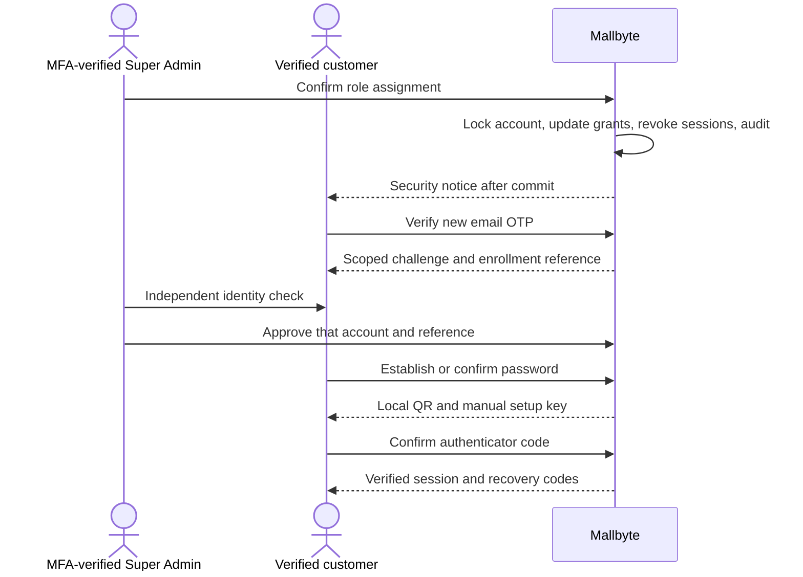

# Privileged role onboarding

A Super Admin can promote an existing email-verified shopper in **Super Admin → Users → Assign role**. The assignment takes effect in RBAC immediately. The account needs a fresh, MFA-verified session to use it. Assigning a Mallbyte role preserves the user's Django staff and superuser flags.

## Who needs MFA

Staff, superusers, Django review moderators with `reviews.change_productreview` (directly or through a group), and holders of active platform permissions require MFA. Mallbyte reads the current role links and their expiry times from PostgreSQL. Custom permission codenames default to privileged. Catalog management also honors the legacy product administrator role, and the policy covers the existing content and vendor management role checks.

The seller-scoped capabilities `add_product`, `edit_own_product`, `delete_own_product`, `view_own_orders` and `view_seller_analytics` permit ordinary seller authentication. A role mixing these with a platform capability requires MFA. Role level has no bearing on this decision. An ordinary customer can still register and sign in with email OTP.

## Approve and enroll

1. The Super Admin signs in with email OTP and their authenticator or an unused recovery code. Locate the target under **Users**. Confirm the account ID, verified email and intended role before confirming the assignment. The Roles & permissions tab also accepts a user ID directly.
2. The target receives a security notification and signs in at `/auth` with a fresh email OTP. A new enrollee sees an enrollment reference. It is bound to this account and this five-minute browser login attempt.
3. The Super Admin verifies the person's identity **in person or using an independently established contact channel**. Call a number already on file or follow the organization's identity-proofing procedure. A reply from the target's email address, or possession of the reference alone, is insufficient.
4. In **Users**, locate that account again and select **Approve enrollment**. Enter the reference provided during the independent check and confirm. The target and approver must be different people. Restarting after expiration requires a fresh reference and approval.
5. An OTP-only user chooses a password that satisfies Django's password validators. An existing password holder confirms their own password. The approved challenge holds only the candidate password hash. The permanent password is established in the same transaction as successful TOTP confirmation. Public email recovery cannot establish the first privileged password.
6. Scan the locally generated QR code or enter the manual key into Google Authenticator, Microsoft Authenticator or another RFC 6238 application. Enter the current six-digit code. Save the ten single-use recovery codes privately, then confirm that they have been saved.
7. Subsequent logins use email OTP and TOTP or one unused recovery code. Enrolled administrators keep their existing device and recovery codes. Multiple granted modules remain available in workspace navigation. CMS opens at `/admin/content`, product categories at `/admin/categories`, vendor management at `/admin/sellers`, finance at `/admin/financial`, inventory at `/admin/inventory`, support at `/support`, and observability at `/admin/observability`. Superusers land at `/admin/super`.



A newly operator-provisioned Super Admin created through Django's trusted `createsuperuser` path may bootstrap with their pre-established password and email OTP. Ordinary promotions and migrated accounts do not acquire that bootstrap credential. Changing the password, email or staff/superuser flags clears its provenance. An email password reset cannot establish that trust. Once enrolled, the normal second-factor verification applies.

## Session and recovery controls

- Access and refresh JWTs bind the account security epoch to the MFA device version and a digest of effective platform permissions. First factors bind the user epoch and effective policy. The server evaluates expiration at request time.
- Assignment, reactivation, custom-role edits, removal, model saves and Django group membership changes compare the effective grants. A real change revokes outstanding sessions and pending email/MFA challenges. Overlapping grants preserve unaffected roles. The application locks the account for authenticated API requests and writes changes transactionally. A request already authorized before revocation can finish before that revocation commits.
- Setup and verification are throttled, have bounded attempts and consume expiring challenges. A successfully used TOTP time step or recovery code cannot be reused. A restarted successful setup supersedes other pending challenges. The scheduled retry task also scrubs expired candidate password hashes.
- The Users screen shows verified email, suspension, role assignments, pending enrollment, device enrollment and current session eligibility. **Privileged session active** means a verified refresh session was issued, remains unexpired and matches the current policy, user and device versions. It does not indicate that a browser is online. Repeat the search on the Users screen to refresh the status after enrollment, sign-in or revocation. The console never returns setup keys, recovery codes, passwords or tokens for another account.
- Security messages use the configured Django mail backend after commit. A durable database record, per-record delivery lock and stable Message-ID suppress repeat deliveries. Celery beat retries pending notices every five minutes. SMTP cannot guarantee exactly-once delivery if the provider accepts a message immediately before the worker loses its database connection. Monitor unsent notices, SMTP delivery and worker/beat health.
- Keep `MFA_FERNET_KEY` stable and backed up with controlled access. Synchronize system clocks. Keep application logs, browser tracing and screenshots free of authentication payloads. Production disables Django's native admin. In development its authenticated pages require the current MFA-verified device session.

For a lost device, try one recovery code first. A password reset preserves the enrolled device. If all factors are lost, open an internal recovery case. An MFA-verified Super Admin must independently verify the person's identity and record the case identifier. Send an authenticated POST to `/api/rbac/console/users/<user-id>/reset-authenticator/` with `{"identity_verified":true,"case_reference":"SEC-1234"}` through the authorized operations client. Keep proof in the restricted case system. Reset invalidates the device, recovery codes, pending challenges and sessions and sends a security notice. The target must repeat independently approved enrollment. Self-reset is blocked. A Super Admin reset needs another enrolled Super Admin. Keep at least two enrolled custodians and test backup restoration. If none can authenticate, use the organization's audited operator recovery and verified backups.

## Rollout

1. Rehearse using an isolated copy and a test mail backend. Verify the database/media backups, escrowed Fernet key, authorized operators, worker, beat, clock and email delivery. Arrange independent verification appointments for affected staff.
2. Coordinate both application versions. Quiesce old API workers during rollout so that an old process cannot authorize using the previous policy. Run the normal approved release workflow with the existing environment and secrets. See [deployment procedures](deployment.md).
3. Run the following inside the backend application container with its normal settings, as part of the approved release. The inventory is read-only. Using `--list-ids` adds internal IDs for private operator follow-up.

```sh
python manage.py migrate --plan
python manage.py migrate --noinput
python manage.py check
python manage.py privileged_enrollment_status --list-ids
```

4. Migrations `accounts.0019` and `accounts.0020` add onboarding, notification and session-status metadata. They preserve existing users, passwords, encrypted devices, hashed recovery codes and business assignments. Existing privileged JWTs and old challenges need a new sign-in. Legacy Django admin sessions must reauthenticate. Roll out the frontend with the API, then verify an enrolled custodian and a delegated user before reopening traffic.
5. For an installation with no enrolled custodian, use the trusted operator process to provision a separately controlled bootstrap Super Admin. Have the custodian establish their password privately, verify email, enroll and independently approve the existing operators. Keep emergency access under audited control. An application rollback to pre-enforcement code would restore the prior authorization behavior. Keep privileged traffic closed during a rollback.

Direct SQL, unrestricted database administration and raw bulk updates outside the supported policy services are trusted operator boundaries. A database administrator can change security state independently of the application. Use model/service paths for changes and reviewed migrations for system policy. Initial identity approval depends on the operator actually performing an independent check. Review-only or custom API permissions without a dedicated Next.js module remain available through their existing authorized API.

## Verification evidence

The isolated browser exercise registered a customer, signed in a separate enrolled Super Admin, assigned a CMS role, confirmed old-session rejection, approved enrollment, established the password, enrolled an authenticator, acknowledged ten recovery codes, entered CMS, signed in again using a fresh TOTP and removed the role. The final API check rejected the formerly verified session. The disposable migration rehearsal compared password, account version, encrypted device, session version, replay counter and recovery hashes before and after upgrade.

| Stage | Sanitized screenshot |
| --- | --- |
| Role assignment | [Confirmation dialog](privileged-onboarding/01-assignment.png) |
| OTP-only account | [New password and independent check](privileged-onboarding/02-onboarding.png) |
| Super Admin approval | [Identity approval dialog](privileged-onboarding/03-approval.png) |
| Local authenticator enrollment | [Masked QR and manual key](privileged-onboarding/04-authenticator.png) |
| Recovery codes | [Masked one-time display](privileged-onboarding/05-recovery.png) |
| Delegated session | [CMS workspace](privileged-onboarding/06-cms.png) |
| Active delegated session | [Enrolled account with an active privileged session](privileged-onboarding/07-session-active.png) |
| After role removal | [Enrolled account after session revocation](privileged-onboarding/08-session-revoked.png) |
