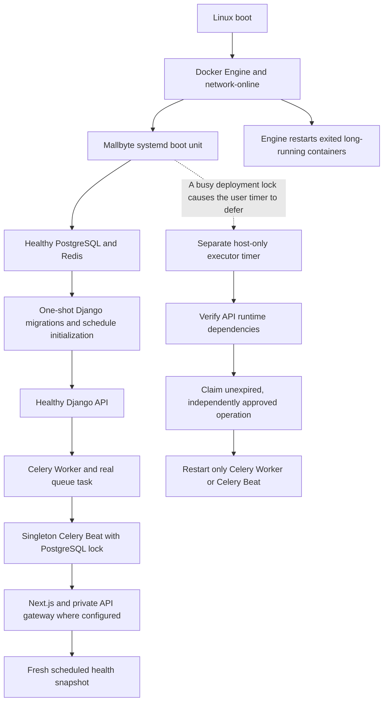

# Linux server bootstrap and recovery

Mallbyte supports a local, system-level Docker Engine and Docker Compose 2.24 or later on Linux with systemd. Run the host commands as the designated deployment user with Python 3.10 or later. Provision Docker and Compose from the distribution or Docker packaging instructions. Give the deployment account access to the local Engine only after reviewing that trust decision. Docker group access effectively grants root-equivalent control of this host. Reserve that access for the deployment account and keep application containers away from the Docker socket.

Use a fixed checkout path on local storage. Install and enable commands require operator access to systemd through ordinary sudo. The bootstrap works from the current checkout, uses a fixed local Docker socket, and supports a configurable Compose project and deployment username. Secrets stay in the environment file with mode `0600`. Keep that file and the unit files under the selected operator's control.

## Startup and recovery flow



A fresh boot command brings services up in the order above. After a daemon restart, Docker may already have started existing containers in parallel. The application entrypoint polls PostgreSQL TCP readiness with a limit, and the boot command checks effective readiness and runs migrations before bringing up missing application services. The boot command uses local images with `--no-recreate`, including when some containers are already running. The deploy command deliberately builds or pulls images and reconciles changed application containers. It pauses Beat during migrations and retains existing PostgreSQL and Redis containers during updates.

## 1. Prepare the environment

Clone a reviewed revision. Keep one operator account and a distinct project name, database, Redis endpoint or isolated instance, and storage per environment. Projects on the same host also need distinct loopback ports.

| Environment | Driver | Default project |
| --- | --- | --- |
| Development | Root `compose.yaml` plus the optional existing local `compose.override.yaml` | `mallbyte-dev` |
| Staging | Backend staging file plus `deploy/compose.remote.yaml` | `mallbyte-staging` |
| Production | Backend production file plus `deploy/compose.remote.yaml` | `mallbyte-production` |

For development, create the root environment once. The initializer safely reuses an existing file. Set the frontend and API ports in the environment file or the existing loopback override.

```bash
python3 -B scripts/init-dev-env.py
python3 -B scripts/mallbyte-server.py plan --environment development
```

For staging or production, provision PostgreSQL and Redis before rollout. Use direct PostgreSQL connections or session pooling for Beat's advisory lock. Use separate SMTP credentials and payment configuration for staging. Copy the sample appropriate to your target to `backend/.env.staging` or `backend/.env.production` **only when that destination does not exist**. Supply actual values privately and set permissions to `0600`.

- Keep `DJANGO_SETTINGS_MODULE=config.settings.production`, `DEBUG=False`, secure redirects and secure cookies on for remote environments. Use independent Django and stable MFA keys. Keep the stable MFA key available for disaster recovery.
- Include the exact API host and `127.0.0.1` in `ALLOWED_HOSTS`. Supply exact HTTPS frontend origins to CORS and HTTPS trusted origins to CSRF. The frontend image embeds `NEXT_PUBLIC_API_BASE_URL`. `INTERNAL_API_BASE_URL` can point SSR to a separately resolved HTTPS API origin.
- Use PostgreSQL TLS. Prefer certificate and hostname validation via `DB_SSLMODE=verify-full` and an available trust root. Production Redis broker, result and cache URLs require `rediss://` with certificate validation. Supply broker and cache isolation per environment. Use SMTP over TLS or SSL.
- Point the site's HTTPS reverse proxy at the private frontend and gateway ports. Configure the proxy to replace client-supplied forwarding headers. The gateway serves public media and static assets. Keep private media mounts inaccessible to the proxy.
- Set `MALLBYTE_BACKEND_IMAGE` and `MALLBYTE_FRONTEND_IMAGE` to new tags when building, or immutable digests when selecting an approved prebuilt release through `--pull`. Keep previous images and record their references with the release.

[Production environment template](../backend/.env.production.example) · [Staging environment template](../backend/.env.staging.example) · [Production gateway and CI release workflow](deployment.md)

## 2. Deploy and install boot recovery

A plan validates Docker connectivity, Compose inputs, ownership of existing containers, persistent mount identities, private port bindings and secrets configuration. It reports validation steps without printing environment values. Launch the release deliberately, and install systemd only after validating the plan.

```bash
python3 -B scripts/mallbyte-server.py plan --environment development
python3 -B scripts/mallbyte-server.py deploy --environment development
python3 -B scripts/mallbyte-server.py install --environment development --linger
python3 -B scripts/mallbyte-server.py install --environment development --linger --apply
```

Pass the same `--environment`, optional `--project` and optional `--user` on each invocation. Run as that user. For an authorized remote environment with verified image references, use `deploy --environment staging --pull` or `deploy --environment production --pull`. Omitting `--pull` builds in the checkout, including the frontend origin. No CD hook is installed by bootstrap. A successful release records its stages in command output. Capture that output in a restricted release log with the selected Git revision and image digests. On failure, the script stops at the failing stage and prints the stage name and status. Inspect application logs privately.

The system unit is enabled for the next boot. `--apply` authorizes installing its unit and the matching user timer. `--linger` separately authorizes enabling the user's systemd manager without login. The user manager can then run the executor each minute. On a dedicated account with linger already enabled, omit that flag. The executor shares the deployment lock and waits for authenticated PostgreSQL and Redis access before claiming work. It relies on the existing independent administrator approvals, expiry, database token, audit log and allowlist. AI diagnosis and manual Redis recovery remain separate workflows.

The schedule installer fills missing rows after migrations. Existing schedules and their enabled flags, arguments and intervals remain in use. A new database gets five-minute snapshots and daily log cleanup. If the same task is configured twice, initialization stops and reports the conflict for operator review. Boot and deploy wait up to 660 seconds for a fresh healthy snapshot. A fresh database may need a second dispatch before the worker can see Beat's persisted run timestamp. For an intentional longer interval, use `--snapshot-timeout SECONDS` at install and deployment. Use `0` only when intentionally deferring the snapshot check and verify the custom schedule separately.

### Adopt an existing service or timer

Check what is installed before use. Do this during an approved maintenance window on the deployment account.

```bash
systemctl cat mallbyte-dev.service
systemctl --user list-timers --all 'mallbyte-observability-ops*'
systemctl --user list-unit-files 'mallbyte-observability-ops*'
loginctl show-user "$(id -un)" -p Linger
```

The installer refuses to overwrite a different system unit or start an executor alongside an enabled or active timer for the same environment. Save the existing unit and timer definitions to restricted storage. Compare working directories and project names, and confirm the existing volume identities with the plan. For an approved adoption, disable the superseded timer using `systemctl --user disable --now TIMER`, and check that no executor invocation is still in flight. Back up and move the conflicting unit files after `systemctl disable UNIT`, then reload systemd and run the install plan again. Keep any unrelated timer and unrelated system unit. The existing root development project retains its configured ports and environment when the same checkout, Compose project and override are used. Moving between checkouts is a separate operation because existing containers are labeled with their project working directory.

### Recovery and maintenance

| Condition | Expected behavior |
| --- | --- |
| An application, database or broker process exits | Docker applies `unless-stopped` with its restart backoff. The migration step has policy `no`. |
| A container stays running but fails health checks | Compose readiness fails and observability reports the health state. Docker restart policy reacts to exit. Worker and Beat recovery can use the independently approved host executor. Investigate PostgreSQL and recover Redis manually. |
| Docker daemon restarts | The Engine restores eligible containers according to restart policy. Review health and use `boot` for explicit reconciliation if needed. |
| Host reboots | The enabled system unit runs boot readiness and reconstruction from local images. The user timer also resumes when the enabled user manager starts. |
| Planned maintenance | Disable the boot unit and executor timer first if maintenance will span a reboot. Stop the project without removing containers or storage. |

```bash
sudo systemctl disable mallbyte-dev.service
systemctl --user disable --now mallbyte-observability-ops-mallbyte-dev.timer
python3 -B scripts/mallbyte-server.py stop --environment development --apply
```

Resume by enabling the units again and using `python3 -B scripts/mallbyte-server.py boot --environment development`. The system service is oneshot and has no stop hook. Stopping the unit alone leaves Docker services running. Use `uninstall --environment development --apply` to remove matching managed units. Uninstall retains containers, persistent volumes, Docker enablement and the user's linger preference. A failed boot remains visible as a failed systemd unit for investigation rather than repeatedly applying migrations.

## 3. Verification and troubleshooting

Use the corresponding project and manifest flags for remote service logs. For the default development project, run the following from the same checkout.

```bash
systemctl is-enabled docker.service mallbyte-dev.service
systemctl status mallbyte-dev.service
journalctl -b -u mallbyte-dev.service
systemctl --user list-timers --all 'mallbyte-observability-ops*'
docker compose -p mallbyte-dev ps
docker compose -p mallbyte-dev exec -T web python manage.py verify_platform_runtime dependencies
docker compose -p mallbyte-dev exec -T web python manage.py verify_platform_runtime worker
docker compose -p mallbyte-dev exec -T web python manage.py verify_platform_runtime snapshot \
  --since "$(date -u -d '10 minutes ago' --iso-8601=seconds)"
python3 -B backend/deploy/observability_ops/host_runner.py \
  --environment monorepo --project mallbyte-dev --dry-run
```

For a boot rehearsal, use a disposable Linux VM with isolated data, ports and credentials. Install the units, confirm the app and worker work, then reboot the VM. Verify the journal for the new boot ID, Docker container health and a snapshot created after that boot. Sign out of the VM console during the rehearsal and check that the timer fired without a login. An isolated Compose stop followed by `boot` tests orchestration but only a real VM reboot exercises kernel, unit enablement and linger together.

If boot reports a project path mismatch, compare labels from `docker compose ps` and the checkout used by the existing stack. If the dependency probe fails, check PostgreSQL TLS and Redis credentials or reachability. If a fresh snapshot is missing, inspect both Celery service logs, check that exactly one Beat holds the PostgreSQL lock, and review the health task's enabled flag and schedule. A second managed dispatcher for the same database exits without publishing. Retire any legacy Beat before rolling out the lock-aware version to the same database.

## 4. Rollback, backup and restore

Record the current application image digests, Git revision, settings and volume identities before rollout. Verify that an independently managed backup is recent and can be restored. The deployment script stops on failure and retains data. For a compatible schema, restore the previous image references and redeploy them with the same project and volumes. A newer schema or application writes may make an image rollback incompatible. For irreversible schema changes, stop writers and follow the tested data recovery procedure. Treat restoration as a separate authorized operation and review lost-write and payment reconciliation implications.

- PostgreSQL. Use a matching PostgreSQL client and the existing encrypted-offsite backup process. Test custom-format dumps with `pg_restore --list`, verify checksums and rehearse on an isolated staging database with its own credentials. The restore tooling includes target guards. [PostgreSQL backup and staging restore](../backend/docs/STAGING_AND_RECOVERY.md)
- Media. Back up public and private media separately using host/provider snapshots or authenticated external copies. Quiesce writes or coordinate the snapshots with the database so file references and objects agree. Encrypt private media, preserve ownership and modes, restore to separate volumes first, and check both public delivery and private authorization.
- Redis. Treat the broker differently from disposable cache data. Use provider-managed persistence or back up the configured RDB/AOF files from a consistent snapshot. Test restoring onto a separate Redis instance. Inspect queued tasks and coordinate with PostgreSQL before restoring broker data to avoid replay. Use application reconciliation for orders and financial operations before resuming workers.
